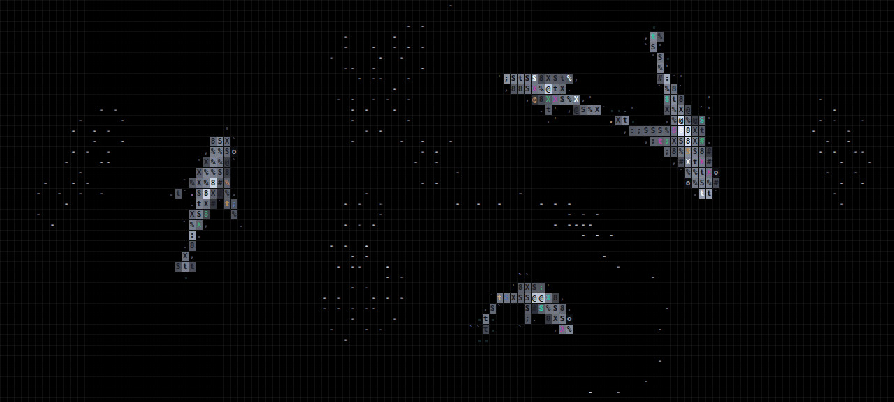

# ascii koi

```
               __
     __     _.-"'  "-._     __
    /  \_.-'  _.._    "-._/  \
    \__/    .'_\/_'.      \__/
       |    /      \      |
       |    \_.--._/      |
       |      /  \        |
        \    /_/\_\      /
         '-._\__/_.-._.-'
```

Koi and shoaling fish drawn as ASCII on a canvas. Zero dependencies.

```sh
npm install && npm run dev
```

```ts
import { OceanEngine } from "./src";

const engine = new OceanEngine(canvas, [{ kind: "kohaku", size: 1 }]);
```

## Proof

Short run recording:

- [Video proof (MP4)](./proof/ascii-koi-proof.mp4)

Preview:


